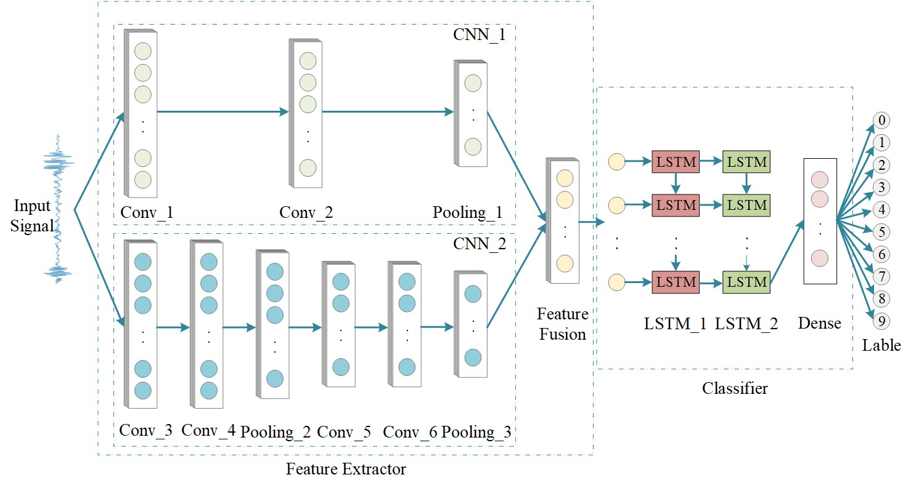

# Bearing Fault Diagnosis

> This repository has been released for 6 years, and the paper and code repository continue to receive a great deal of attention. We sincerely appreciate the interest from readers. 
> 
> However, since the Keras and TensorFlow packages have been updated significantly, many APIs are no longer available. Therefore, we have converted the `Keras` code to `PyTorch`; see [cnn_lstm_model.py](cnn_lstm_model.py). 
> 
> And the `Keras` version [cnn_lstm_model.ipynb](cnn_lstm_model.ipynb) will no longer be maintained.

This is the official baseline of the paper: [*Bearing fault diagnosis base on multi-scale CNN and LSTM model*](https://doi.org/10.1007/s10845-020-01600-2)

Dataset: [CWRU Bearing Data Center](https://engineering.case.edu/bearingdatacenter/welcome).
Place the `.mat` files in the `./data` folder.

If you find this paper helpful, please consider citing it!

```text
@article{chen2021bearing,
  title={Bearing fault diagnosis base on multi-scale CNN and LSTM model},
  author={Chen, Xiaohan and Zhang, Beike and Gao, Dong},
  journal={Journal of intelligent manufacturing},
  volume={32},
  number={4},
  pages={971--987},
  year={2021},
  publisher={Springer}
}
```



## See our related projects

- Deep Transfer Learning for Bearing Fault Diagnosis: A Systematic Review Since 2016. [[paper]](https://ieeexplore.ieee.org/abstract/document/10042467) [[code]](https://github.com/Xiaohan-Chen/fault-diagnosis-transfer-learning-pytorch)
- TFPred: Learning Discriminative Representations from Unlabeled Data for Few-Label Rotating Machinery Fault Diagnosis [[paper]](https://www.sciencedirect.com/science/article/pii/S0967066124000601?dgcid=author) [[code]](https://github.com/Xiaohan-Chen/TFPred)
